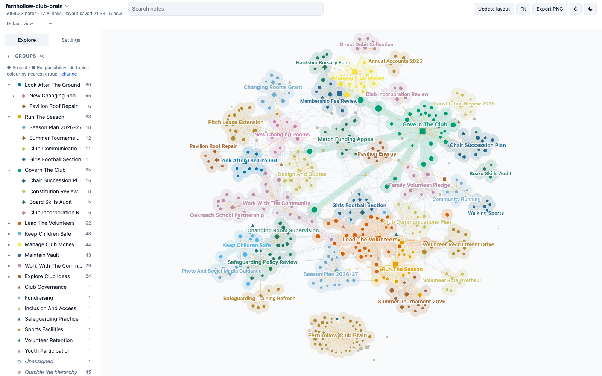

# Fernhollow Club Brain

A demo Second Brain: about 500 linked Markdown notes holding the working memory of the volunteer chair of a fictional neighbourhood football and athletics club. Clone it, open the folder, and explore what a vault looks like after two years of daily use: projects, decisions, meetings, people, reading, open questions, and the links between them.



**[Explore this vault in the live demo](https://mfoll.github.io/brain-graph-demo/?vault=fernhollow-club-brain)**: its map in Brain Graph, in your browser, with nothing to install.

> [!warning]
> Everything about the club is fictional: Fernhollow Sports and Youth Club, every person, the council, school, trust, governing bodies, businesses, places, decisions and figures. Any resemblance to real people or organisations is accidental. Only the Sources marked as encyclopedia articles or documentation are real.

## What it shows

The vault was deployed from the [Second Brain template](https://github.com/mfoll/second-brain-template), which adds operating rules, workflows and a decision record to the [Portent](https://github.com/refactoringhq/portent) note model. Everything is plain files: Markdown notes with YAML frontmatter, typed relationships (`belongs_to`, `related_to`, `has`) and wikilinks. No app, database or index is required.

| Area | What to look at |
| --- | --- |
| Structure | 8 Responsibilities at the root, about 25 Projects under them, 10 Topics as lateral context; every note rolls up to a Responsibility. |
| Memory | About 180 Sources, 50 Events, 35 Questions, 30 Concepts, 15 Opinions, 15 Recaps and 40 people. |
| Real material | About 60 Sources are real English Wikipedia articles on volunteering, governance, grants, coaching and safeguarding, cited with title, URL and licence and summarised in our own words. Their "Why It Matters" sections describe how the fictional club uses them. |
| Operations | `AGENTS.md`, Type notes, Procedures, Skills and ADRs from the template, unchanged except for the deployment steps. |
| History | Git history from January 2025 to October 2026, one commit per month of captures. |

## Open it

- **Any Markdown editor.** Clone the repository and open the folder. Start from [[vault]].
- **[Tolaria](https://tolaria.md/).** Open the folder as a vault for typed sidebars, relationship panels and saved views.
- **[Brain Graph](https://github.com/mfoll/brain-graph).** See the whole vault as a map coloured by project:

  ```bash
  npx github:mfoll/brain-graph path/to/second-brain-demo-community-club
  ```

- **A coding agent.** Run Claude Code, Codex or Gemini CLI in the folder. They read [[AGENTS]] (through `CLAUDE.md` and `GEMINI.md` where needed) and follow the vault's Procedures.

## Try this

Each question has a known answer in the vault, so you can check what an agent finds.

| Ask | Where the answer lives |
| --- | --- |
| Who voted against the 2026 fee rise, and what came of it? | The membership secretary, on 10 March 2026; the compromise was a hardship bursary. See [[board-meeting-2026-03-10]] and [[hardship-bursary-fund]]. |
| Did we drop the family volunteer pledge? | Partly: the opt-out fee went on 10 February 2026, the pledge stayed as an ask. See [[family-volunteer-pledge]] and [[board-meeting-2026-02-10]]. |
| What could still sink the changing rooms grant? | The council lease decision, deferred to November. Still open. See [[changing-rooms-grant-application]] and [[council-cabinet-deferral-2026-09-17]]. |
| How does the safeguarding review shape the new changing rooms? | Interim supervision rules now, separate junior rooms in the design. See [[changing-room-supervision-rules]]. |
| Where is the match funding for the changing rooms coming from? | Reserves, a council grant and an appeal. See [[match-funding]]. |
| When does Hazel step down, and who might take over? | At the June 2027 AGM; the co-chair question is still open. See [[chair-succession-plan]] and [[should-fernhollow-have-co-chairs]]. |

Workflows to try with an agent:

- **Resume a project:** "Resume the New Changing Rooms project."
- **Process the Inbox:** about eight raw captures from the last weeks of October 2026 have `_organized: false`; each has an obvious home.
- **Ingest an article:** give any Wikipedia article on volunteering, youth sport or charity governance and ask where it belongs.
- **Lint the vault:** run the template's audits and review what they report.

## Scope and privacy

The fictional club's board, volunteers, safeguarding policy, money, ground, season, community relationships and the chair's exploratory reading. Children are never named, safeguarding cases never enter the vault, and hardship bursaries appear only as counts. Members' personal data stays in the club's membership system; notes point to it through Source notes.

## Template updates

The vault was deployed from the template on 2026-10-23. Later template improvements can be ported with [[upgrade-existing-vault-from-template|Upgrade an Existing Vault From the Template]], as a reviewed change: an agent proposes each port, and a person approves it. Never run it unattended. A vault in use is expected to differ from the template on purpose, in its ADRs, Procedures, Skills and instructions.

## How it was made

An AI agent drafted the world specification (the club, people, projects, timeline and the storylines behind the questions above) and a person reviewed and changed it. AI agents then wrote the notes from it, one per area of the club, and retrieved the real articles from Wikipedia. The links, frontmatter, cross-area consistency and article metadata were checked with the template's lint scripts and against Wikipedia.

## Storage and backup

Git history in this repository. A demo that edits notes can be reset with `git checkout .` and `git clean -fd`.

## More example vaults

This is one of nine fictional vaults deployed from the same template, each kept by a different kind of person: a lab head, a café owner, a teacher, a freelance designer, a parent running a household, a sports club chair, a novelist, a start-up engineering lead and an HR assistant. The [template README](https://github.com/mfoll/second-brain-template#example-vaults) lists them all.

## Licence

MIT, see `LICENSE`, which also covers the template material. `THIRD_PARTY_NOTICES.txt` lists upstream notices. Cited articles remain under their own licences; the notes contain only their metadata and our own summaries.
